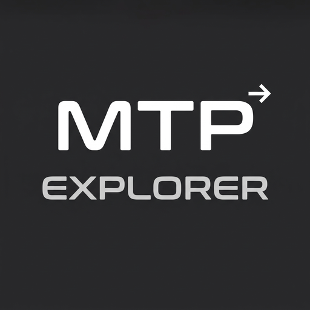
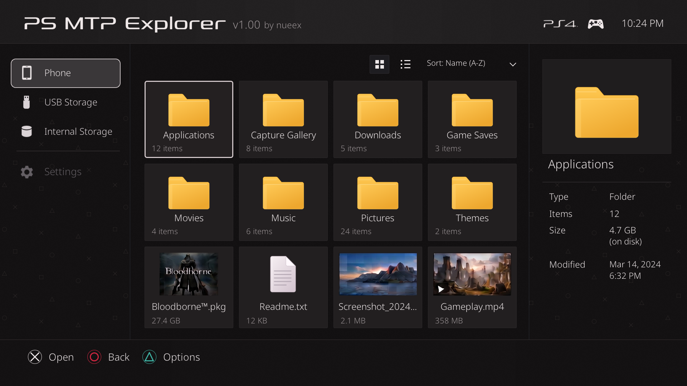

  

<h1 align="center">PS MTP Explorer</h1>

<strong>Your phone. Your USB drive. Your PS4. One file explorer.</strong> by nueex

> **Project summary:** ps-mtp-explorer is a PS4 homebrew utility by nueex for direct Android to PS4 USB file transfers, with support for direct PKG installation. Browse your phone over MTP, move files between phone, USB drive and internal HDD, and install packages without a PC, FTP server or local network setup.

  
  
  
  
  

  <a href="https://github.com/nueex/ps-mtp-explorer/releases/latest"><strong>Download PKG</strong></a> ·
  <a href="#getting-started">Getting started</a> ·
  <a href="BUILD.md">Build from source</a> ·
  <a href="#install-pkg-from-phone-to-ps4">Install packages</a> ·
  <a href="#controller-guide">Controls</a> ·
  <a href="https://github.com/nueex/ps-mtp-explorer/issues">Report an issue</a>

---

## Everything in one place

| Capability | What you can do |
| :--- | :--- |
| **Direct phone-to-PS4 transfer** | Browse Android files and transfer them directly over USB MTP, without a PC or network setup. |
| **Internal & USB storage** | Browse PS4 internal storage and connected USB drives alongside your phone. |
| **Transfers in both directions** | Copy files and complete folder trees from phone to PS4/USB, from PS4/USB to phone, and between writable native storage locations. |
| **Familiar file actions** | Copy, Move, Paste, Rename, Delete and Properties across your phone, USB drive and internal HDD. |
| **New Folder** | Create a directory in the current writable location with the on-screen keyboard. |
| **Direct PKG installation** | Supports installing PKGs directly through the app from your phone, USB drive or internal HDD. |
| **Reliable transfers** | Built-in integrity checks help protect your files during transfers. |
| **Live updates** | Connected devices and folder contents update automatically as you manage your files. |
| **Grid, list & details** | Switch views, inspect full paths and file properties, and see supported image previews, package artwork and available media metadata. |
| **Seven sorting choices** | Name A–Z/Z–A, size smallest/largest, modified newest/oldest, or file type. Folders stay grouped first. |
| **Designed for the controller** | Browse and manage your files from the controller, with an on-screen keyboard for folder and file names. |

   
  Interface preview rendered from the app using sample files.

## Hardware safety

PS MTP Explorer uses standard USB data transfers and is electrically safe under normal operating conditions. Read the [Hardware Safety & Electrical Analysis](HARDWARE_SAFETY.md) for clear answers about fast-charging phones, the Southbridge, large transfers, and safe cables.

## Getting started

### What you need

- A jailbroken **PS4 with GoldHEN active**.
- A controller and enough free storage for your transfers or installations.
- For phone access: an **MTP-capable Android phone** and a **USB data cable**. Unlock the phone and choose **File Transfer / Android Auto (MTP)** from its USB options. No companion phone app is required.
- For USB storage: a drive that your PS4 exposes as a mounted USB storage device.

**Tested on PS4 firmware 9.00, 10.01 and 11.00 with GoldHEN active.**

### Install and open

Download **[PS-MTP-Explorer-1.01.pkg](https://github.com/nueex/ps-mtp-explorer/releases/download/v1.01/PS-MTP-Explorer-1.01.pkg)** and install it using GoldHEN's package installer. Version **1.01** updates the existing `NUEX00001` app; its PS4 `APP_VER` and `VERSION` metadata are **01.01**. The previous [1.00 release](https://github.com/nueex/ps-mtp-explorer/releases/tag/v1.00) remains available.

Then:

1. **Connect your phone via USB.** Unlock it and select File Transfer / MTP.
2. **Launch PS MTP Explorer.** Choose your phone, USB drive or internal storage.
3. **Manage files or install PKGs.** Browse folders, copy or move files, or select a package to install.

## Copy or move files

Use PS4 MTP transfer to move files between Android and your console, or manage files across internal storage and USB drives.

1. Highlight a file or folder and open **Options**.
2. Choose **Copy** or **Move**.
3. Browse to the destination on the phone, USB drive or internal storage.
4. Open **Options → Paste**, review the operation, then confirm with **X**.

Transfers include folder contents. Existing destination names are protected rather than silently overwritten. Supported large-file transfers can exceed 4 GB; phone uploads require the phone's large-file MTP support and a destination filesystem that permits the file size.

Use **Options → New Folder** to create a destination folder. For internal storage, use writable locations such as `/data`; other system locations may be browse-only. Phone write, rename and delete actions depend on the operations exposed by that phone.

Use **Properties** to inspect a file's size, full path and available metadata.

## Install PKG from Phone to PS4

Highlight a `.pkg`, press **X** and confirm **Install**. The app supports direct PKG installation from your Android phone, USB drive or internal HDD.

| Package location | Installation workflow | Source after installation |
| :--- | :--- | :--- |
| **Internal storage** | Install directly from the internal HDD. | Original PKG is kept. |
| **USB storage** | Install directly from the USB drive. | Original PKG is kept. |
| **Phone over MTP** | Select a PKG on your phone; the app prepares it automatically. | Original PKG on the phone is kept. |

For phone installations, leave enough internal space for **both the temporary PKG and installed content**. Keep the source connected and the app open until installation finishes.

**Package installation:** Select a PKG from your phone, USB drive or internal HDD and install it through the app. GoldHEN must already be active.

## Controller guide

| Button | Action |
| :--- | :--- |
| **D-pad** | Navigate files, folders, menus and storage devices. |
| **X** | Open a folder; review installation for a PKG; show Properties for another file; confirm a selected action. |
| **Circle** | Go back, close a dialog or cancel an operation. |
| **Triangle / Options** | Open the Options menu. |
| **L3** | Toggle Grid / List. |
| **L1 / R1** | Previous / next page. |
| **L2 / R2** | Previous / next available phone storage area. |
| **Touchpad** | Refresh devices and the current view. |
| **Left from the file area's left edge** | Enter the device sidebar. |

## Build from source

See [BUILD.md](BUILD.md) for the required tools, SDK setup, production PKG
build commands, package validation, and optional CMake host library build.
Application source, bundled artwork, fonts, and the libjbc integration are
included in this repository; install the external compiler and OpenOrbis SDK
as described in the guide.

## Common questions

<strong>My phone appears, but I cannot open it.</strong>

Unlock the phone, choose File Transfer/MTP, and approve any device-side USB access prompt. Use a data-capable cable. Refresh or relaunch the app after changing the phone's USB mode. MTP implementations vary; phone-specific restrictions can affect browsing and writes.

<strong>Can I use an iPhone?</strong>

This release targets phones exposing standard MTP storage. iPhone file access is not supported.

<strong>Why does a phone PKG need extra internal space?</strong>

Phone package installation requires free internal storage for both the package and installed content. Your original phone file is kept.

<strong>Where are downloads and source code?</strong>

The application source and build scripts are included in this repository; follow [BUILD.md](BUILD.md) to compile your own copy. Previously released binaries retain their accompanying notices. See [LICENSING.md](LICENSING.md) for the current original-work GPL grant and unresolved requirements for distributing the complete application.

## Feedback

[Open an issue](https://github.com/nueex/ps-mtp-explorer/issues) with your PS4 firmware/GoldHEN version, phone model and Android version if relevant, the storage source/destination, and steps to reproduce the issue. Include the error shown on screen.

## Support / Donate

If PS MTP Explorer makes managing your PS4 easier, you can support development on Ko-fi. Thank you for helping the project continue.

## Credits & third-party notices

**Original Author: nueex — Copyright (C) 2026 nueex** (original project work). Built with [OpenOrbis](https://github.com/OpenOrbis/OpenOrbis-PS4-Toolchain), musl, stb and Noto Sans.

**libjbc - PS4 Jailbreak C library by sleirsgoevy, with modifications by bucanero. Provided and used with full author attribution for PS4 homebrew execution.**

Additional libjbc contributor: **LightningMods**, for upstream Sony credential/capability handling.

See [THIRD_PARTY_LICENSES.md](THIRD_PARTY_LICENSES.md) and the third-party materials attached to the release for component notices. PS MTP Explorer is an independent homebrew project and is not affiliated with Sony Interactive Entertainment.

## License and scope

**nueex's original work is licensed under GNU GPL v3.0-or-later (`GPL-3.0-or-later`)**, effective 2026-10-26. You may redistribute and/or modify the covered work under GNU GPL version 3 or, at your option, any later version. It is provided **WITHOUT ANY WARRANTY**, including MERCHANTABILITY or FITNESS FOR A PARTICULAR PURPOSE. See the complete [LICENSE](LICENSE), [licensing scope](LICENSING.md), and explicit [file/contribution inventory](LICENSE_SCOPE.json).

The grant covers original application code, project-specific UI/design, authored icons and artwork owned by nueex. Mixed files are covered only for nueex's original contributions. Third-party libraries, OpenOrbis-derived material, fonts, trademarks and externally owned artwork retain their existing terms. No whole-file GPL-3.0-or-later grant is asserted for libjbc or mixed assets.

**The complete application/source bundle is not cleared for redistribution.** libjbc's inherited-code permissions and excluded third-party artwork/branding remain unresolved; see [LICENSING.md](LICENSING.md) and the [asset inventory](LICENSING_ASSETS.json). This status does not limit the GPL grant for nueex's original work. No component, feature or UI appearance was changed by this migration.

Previously MIT-licensed versions and material retain their original permissions. The complete [historical MIT notice](LICENSES/MIT-legacy.txt), including existing copyright notices, is preserved. These GPL notices do not revoke prior MIT grants or grant new rights to third-party content. Historical releases and archives are unchanged.

---

<strong>GoldHEN file manager | PS4 MTP transfer | Android to PS4 USB | Direct PKG installation</strong> PS MTP Explorer by nueex

